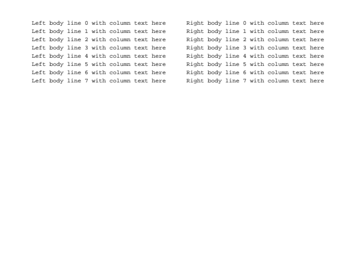
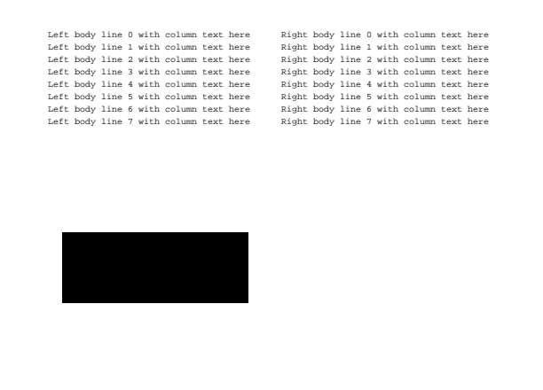

# Columns PR1 — native Linux evidence

This is the **existing PDF reader, not a Columns UI**. PR1 adds only page
geometry and a pure Dart analyzer; the app does not call it yet. The recording
shows the original Thrift page, a forward/back page turn, and its text-selection
surface with Note/Copy/Search controls. The images show the original page and
an Abstract selection. They demonstrate that the existing app still reads the
corpus, not the analyzer's ordering (which the unit corpus verifies).

## Current follow-up — exact phone-reported pages

Darwin's iPhone findings supersede the broad fallback accepted in the earlier
Oracle review. On the earlier approved head, the real engine/analyzer probe
reproduced Thrift pages **2/6/7** falling back and **9/12 ResNet pages** falling
back, including page 1 and all figure/table pages. Attention remained one-column.

Current results, from real local PDFium extraction and rasterization:

- **Thrift: 8/8 pages split into two columns.** Inline raster hyphens no longer
  create overlapping figure crops.
- **ResNet: 12/12 pages split into two columns.** Connected vector objects,
  plot/network labels and table cells own indivisible figure regions before
  body-gutter inference. Body columns remain around them.
- **Attention: 15/15 pages remain no-gutter fallbacks**, with safe margins
  trimmed. Unknown painted coverage still retains full-page bounds.
- **All 35 real paper pages: zero missing and zero repeated painted pixels**
  at 1×, excluding only deliberately suppressed recurring folios. The
  [per-page executed output](paper-raster-checks.txt) records counts and region
  totals. The retained optional original-PDF test rechecks all 27 ResNet and
  Attention pages; their non-CC originals are not redistributed. CI uses
  prose-free numeric/hash geometry facts instead. See the
  [corpus rights and reproduction](../../../fixtures/pdf-columns/README.md).

Physical rows also expose genuine cuts. Thrift page 1's former four-baseline
338.1–378.1 loose box becomes painted rows **339.876–347.255**, **349.836–357.906**,
**359.796–367.866**, **369.756–377.826**. Page 4's former five-row block and page
3's Utilities block have analogous retained regressions. Grouping compares a
representative row, not the accumulated union; raised glyphs remain inline.
Selection retains loose boxes and unchanged canonical character offsets.
Region crops separately add 1pt raster padding limited at whitespace
midpoints, so tight row cuts do not discard antialiasing at crop edges.

Checks: `make lint check-fmt` passed all three analyzers (**255 files, zero
format changes**). `flutter test test/reader/pdf test/visual/production_shell_golden_test.dart`
passed **65 tests (54 PDF + 11 goldens)** with zero pixel drift. The optional
pinned-original checks passed independently. All **eight fixture hashes** pass.
No golden baseline changed. The full `make test` was not repeated for this
localized follow-up; its initial core-test orb OOM limitation remains below.

Inline self-review covered the complete diff: no paper-specific production
branches; figure/label exact-once ownership after final crop padding; real body
gutter rather than table/plot gaps; R2L, rotated coordinates and offsets;
unknown-coverage fallback; physical rows/superscripts; and source rights.
Changed old fallback expectations now require columns plus retained ink, not
weaker safety assertions. No review thread/subagent was created. Prior Oracle
sign-off applies **only to the old head**, not this follow-up.

The native app screenshots and recording below are **retained earlier-head
captures**, re-inspected for this follow-up. PR1 still has no Columns view;
these do not certify new-head UI or iPhone/macOS behavior. Current-head runtime
evidence above exercises the actual engine/analyzer boundary PR1 owns. PR2
owns indivisible figure fitting and crisp figure/page pinch; final device
validation must follow its restack.

Captured 2026-11-04 from a debug Linux build of the real `ShosaiApp` and
application core, with Thrift and the synthetic scan imported into disposable
local storage. A temporary bootstrap supplied only that storage/import setup;
no reader widgets, bridge results, geometry or rendered pages were mocked.
The software display was Xvfb + Weston (X11 backend, Pixman compositor), with
GTK using Wayland/EGL and Mesa llvmpipe. Xvfb's GLX visuals were unavailable.
ffmpeg recorded the actual pointer and window at 20fps. Desktop padding was
cropped from the PNGs and video; no app content was composited into them.

- `thrift.png`: original first page, two-column paper, page 1 of 8.
- `selection.png`: existing Abstract selection and floating controls.
- `reader-demo.mp4`: original-page/spread navigation and selection state.

## Initial-head checks

- `.agents/dev make lint`: all three analyzers passed; final Flutter analysis
  after the additional line-extraction regression also reported no issues.
- `.agents/dev make test`: script/codegen checks passed, Flutter **1453 passed,
  3 skipped**, EPUB **178 passed**. The command was then OOM-killed in the
  unchanged core test `a copy cancelled mid-way leaves no destination behind`.
  A standalone core rerun hit the same limit; the workload cgroup recorded OOM
  kills. That test creates `List.filled(256 * 1024 * 1024, 7)` before copying.
  No core production or test code is changed by this PR.
- Core rerun excluding only that named test: **265 passed**. This is an explicit
  validation limitation, **not** a claim that the complete `make test` passed.
- Vendored PDFium hook suite: **7 passed**.
- Final `flutter test test/reader/pdf`: **48 passed**, including the added
  canonical-space/gutter regression after the full Flutter run.
- Production-shell golden harness: **11 passed**, zero pixel drift in every
  baseline comparison; repeated independently after the complete Flutter run.
- `make check-fmt`: **254 files, 0 changed**. Corpus SHA-256 checks: all five OK.

## Initial inline self-review

No inline oracle was available; no review agent or thread was created.
Reviewed the ten-rule PR1/successor boundary, unchanged selection/search
indices, nested image transforms and page rotation/CropBox handling, resource
cleanup and limits, R2L ordering, conservative no-gutter fallback, margin
suppression, fixture rights and image/line conservation. Raster-backed tests
check transformed image bounds, not just object counts. The real arXiv stamp
and rotated-text cases exposed false segmentation during implementation and
are covered by the retained corpus.

No golden baselines changed. Any **macOS golden changes in this stack require
regeneration and verification on the Mac mini**; these Linux captures cannot
certify macOS rasterization.

## Oracle P1 follow-up — painted content preservation

Independent review found that the initial crops could omit vector-only figures
and repeat image labels. This is now guarded by painted-object coverage:
PDFium paths/shadings carry bounds alongside images, and unknown/degenerate
coverage is explicit. Every retained line/image/graphic must fit exactly one
crop, without intersecting a second crop; otherwise the analyzer returns the
complete page. Contained labels are owned by the figure, before its caption.

`content-preservation.pdf` is a reproducible, first-party four-page PDF with
two text columns on each page. The retained regression renders it with PDFium
and checks that each painted pixel is covered by exactly one returned crop.
A temporary comparison ran the initial-head analyzer and the fix over those
same pixels, measuring pixels darker than 245 in any RGB channel:

| Case | Before: omitted / repeated pixels | After: omitted / repeated pixels |
| --- | ---: | ---: |
| Vector-only figure below the final body line | 16,800 / 0 | 0 / 0 |
| Wider vector figure above its caption | 2,160 / 0 | 0 / 0 |
| Image with an overlaid label | 0 / 4,512 | 0 / 0 |
| Axial shading outside the text bounds | 16,800 / 0 | 0 / 0 |

The vector/shading pages conservatively fall back; the labeled image retains
two columns. Existing Thrift/ACM column expectations remain unchanged. Pure
geometry controls also cover unknown graphics, safe contained graphics,
partial image/line intersections and label ownership in full-width figures.

Follow-up checks: `make lint check-fmt` passed (all three analyzers; 254 files,
0 changed); `flutter test test/reader/pdf test/visual/production_shell_golden_test.dart`
passed **61 tests** (50 PDF + 11 goldens), with zero golden drift. All six
fixture hashes pass, including after regeneration. The complete `make test`
was not rerun for this follow-up; its initial orb limitation is recorded above.
No UI or golden baseline changed, and the native app demo above remains the
unchanged reader. Independent Oracle re-review/sign-off is still pending.

The following images show actual PDFium pixels masked by the old/new returned
crops, **not a Columns UI**. Both are cropped to the same page-space area;
the retained pixel counts above come from execution, not the illustration.

