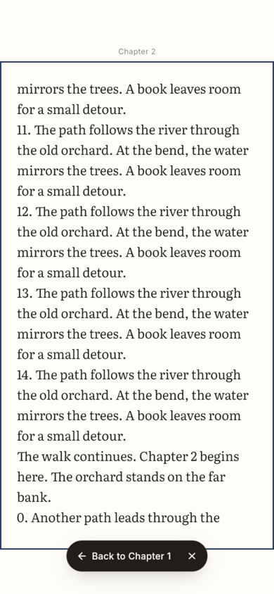
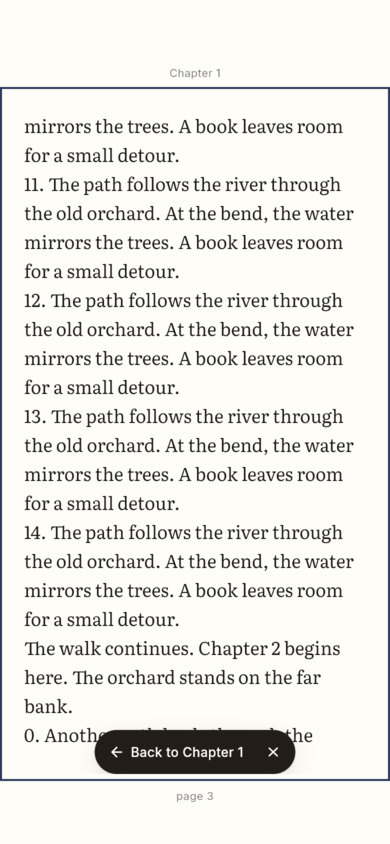
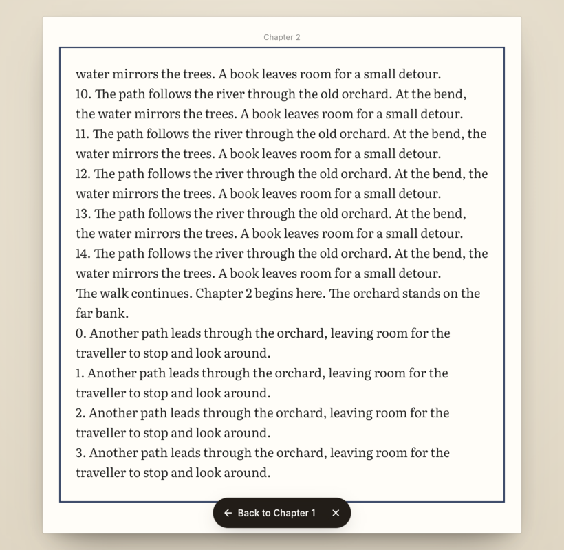
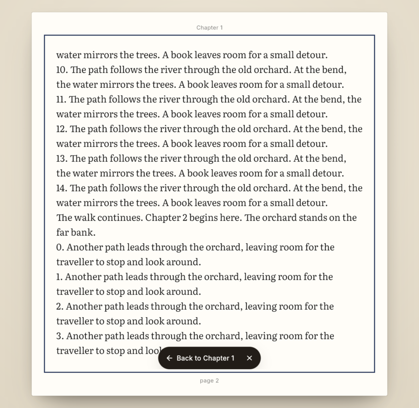
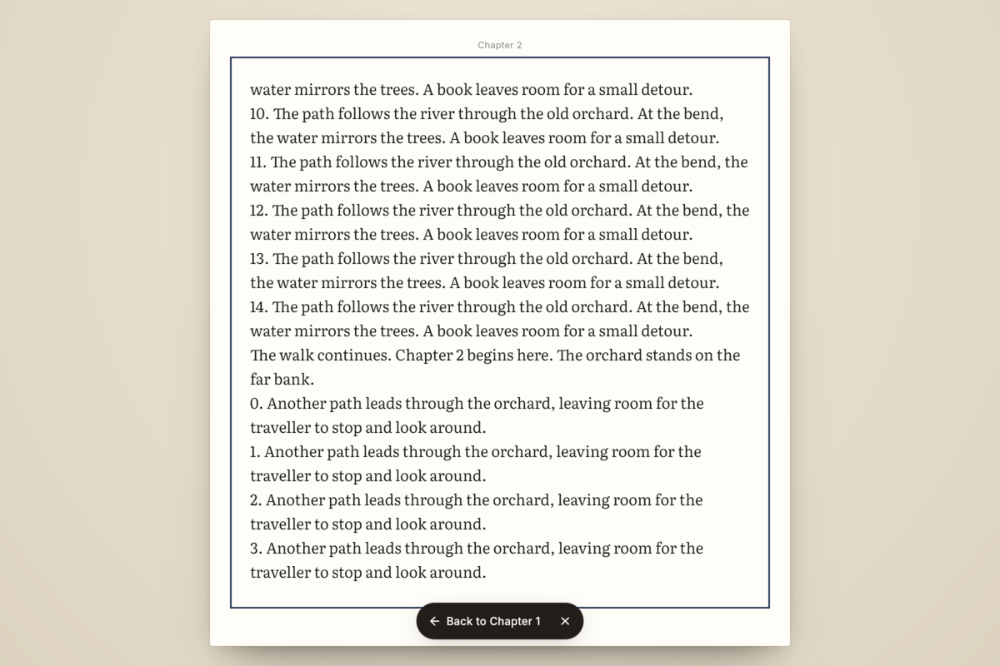
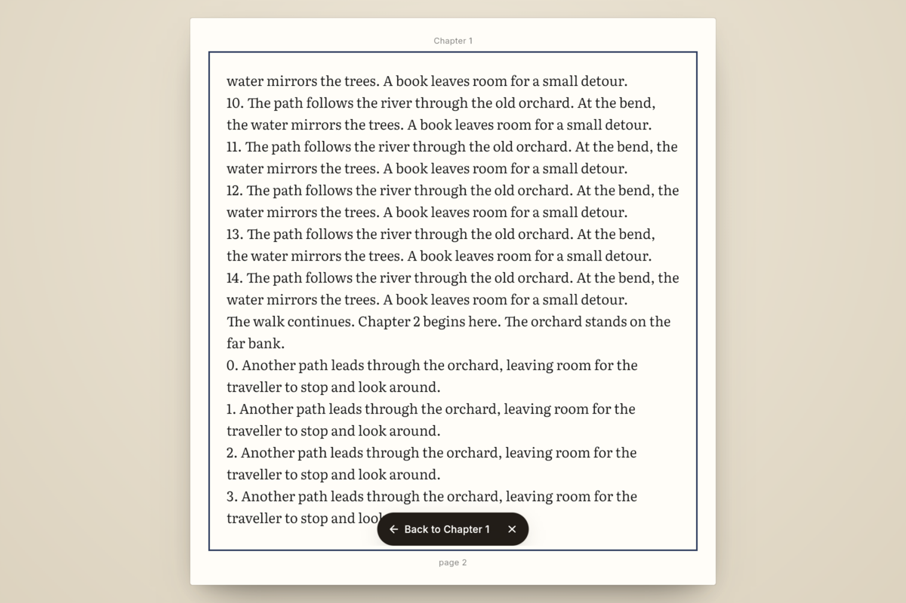
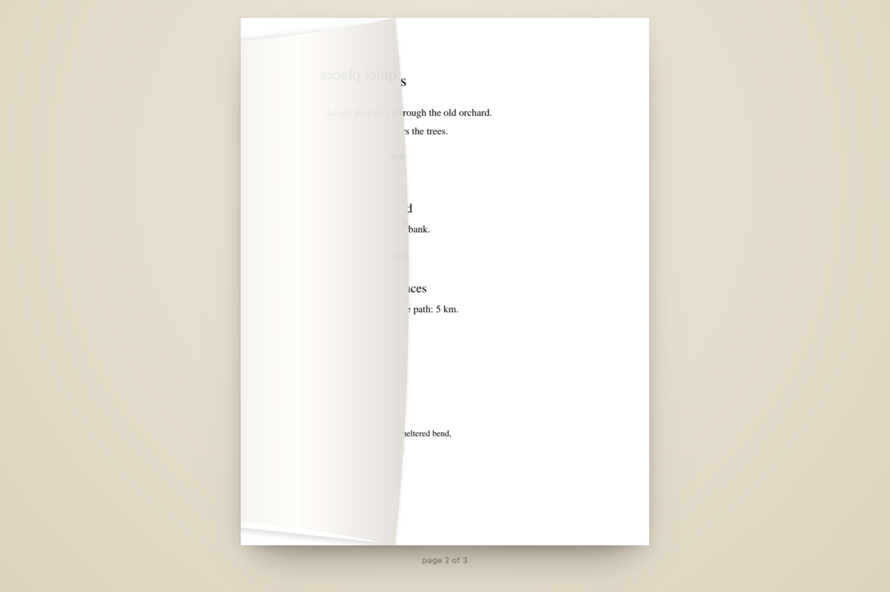
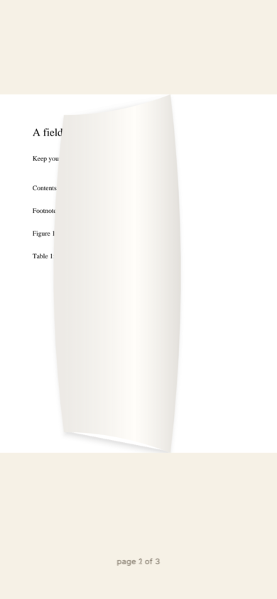

# Quiet-page review

These are captures of the native Flutter application on Linux, using the real
EPUB engine, PDFium and SQLite, not UI mockups. The baseline reader is
[`1db6172`](https://github.com/chaba-dev/shosai/commit/1db6172b).
After screenshots were refreshed after rebasing onto
[`1cd6a1a`](https://github.com/chaba-dev/shosai/commit/1cd6a1af).
Both use the same generated documents and Contents target; the baseline
requires confirming the preview, while current main jumps directly.

The phone viewport is 390 × 844 logical pixels with 59px top and 34px bottom
safe insets; tablet is 820 × 800 and desktop is 1200 × 800. These are simulated
layouts, **not iPhone/iPad/Android device captures**. No builds were installed
on personal devices. Screenshots were captured at 2× and reduced to 1× here.

## Contents jump versus ordinary paging

Chapter 2 starts inside a paragraph on a page whose top is still Chapter 1.
Both routes reach the same canonical page start: 1449 on phone, 1306 on tablet
and desktop. Before the fix, the jump's running head says Chapter 2 while
paging says Chapter 1. Afterwards both say Chapter 1. The precise jump target
and the Contents selection still identify Chapter 2; only page furniture uses
the page top. Book-global page numbering is unchanged.

| Phone | Contents jump | Ordinary paging to the same page |
| --- | --- | --- |
| Before |  |  |
| After |  |  |

The floating Back capsule now stays inside measured content, with a gap above
the folio and below the running head. Visible chrome further bounds that
region; a viewport too short for a touch target hides the capsule rather than
covering furniture. It remains a floating overlay over body text.

| Viewport | Before | After |
| --- | --- | --- |
| Tablet |  |  |
| Desktop |  |  |

## PDF turn

[Before/after PDF turn video](pdf-turn-comparison.mp4)

PDF link annotations are warmed alongside nearby pages. A ready lookup is
consumed directly, without a new worker request or completed-future hop before
the page-zone action. Links still take precedence over page turns. Automatic
PDF curls lift with ease-out rather than a nearly stationary ease-in; the
350ms duration, held gestures and reduced-motion path remain unchanged.

| Before | After |
| --- | --- |
|  |  |

These stills request a capture 80ms after detecting the curl widget; native
frame scheduling and PNG readback mean they are illustrative, not exact
timestamp comparisons. The short video is also **not a latency/FPS benchmark**.
Xvfb reads the GPU window as black in this orb, so the video combines actual
Flutter frame snapshots with the actual X11 pointer recording. Snapshot
timestamps are retained; PNG encoding happens after the turn. The pointer
crosses the previous/next controls and clicks Next through native input.

## Regression coverage and reproduction

- [`quiet_page_test.dart`](../../../test/reader/quiet_page_test.dart): a warmed
  PDF must turn while any new annotation-worker read is held; EPUB/PDF return
  capsules must not intersect furniture with iPhone, Android gesture and
  Android three-button insets, with chrome shown and hidden.
- [`integration_test/quiet_page_test.dart`](../../../integration_test/quiet_page_test.dart):
  real Contents jump, page back/forward, matching page starts and running heads,
  capsule/furniture bounds at all three sizes, and a real PDF curl.
- Existing navigation, selection, drag cancellation, RTL, spread, link refusal,
  reduced-motion and book-global numbering tests remain in the full suite.

```sh
.agents/dev flutter test --no-pub --concurrency=2
.agents/dev flutter analyze --no-pub lib test integration_test
```

Native app screenshots (requires Linux/Xvfb):

```sh
.agents/dev env GDK_BACKEND=x11 \
  __EGL_VENDOR_LIBRARY_FILENAMES="$(.agents/dev printenv SHOSAI_TEST_EGL_VENDOR)" \
  SHOSAI_QUIET_ARTIFACTS="$PWD/.amp/in/artifacts/review" \
  xvfb-run -a -s '-screen 0 1280x1000x24' \
  flutter test --no-pub -d linux integration_test/quiet_page_test.dart
```

Add `SHOSAI_QUIET_VIDEO=1` to record the desktop native-pointer PDF clip as well.
`SHOSAI_QUIET_BASELINE=1` relaxes the corrected heading/geometry expectations
and confirms the old Contents preview when running against the baseline
reader; it does not switch app code. The video predates the unrelated main
updates; the after screenshots and native assertions were rerun after rebase.
